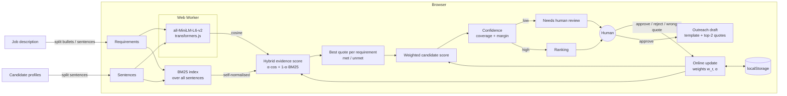

# MatchWhy

**AI proposes, a human approves.** MatchWhy is a candidate↔job matcher built around human-in-the-loop review. Each score comes with a verbatim quote from the candidate's profile for every requirement in the job description. Unmet requirements are shown in red. Candidates the system is unsure about go to a "Needs human review" queue instead of being ranked silently. Reviewers can Approve or Reject a candidate, or mark a quote as "wrong evidence", and each click updates the requirement weights and the embedding-vs-keyword mix through a small online rule that you can read in full. Outreach drafts are built from the candidate's own quotes, and you can only copy one after a human has approved that candidate. Everything runs in the browser: `all-MiniLM-L6-v2` runs in a Web Worker through transformers.js. There is no server, no API key and no paid service.

**Live demo:** _coming soon_

 

## Architecture



If the model can't load (offline, blocked CDN, old browser), the app switches to lexical-only BM25 and shows a banner.

## How it works

### 1. Evidence retrieval (hybrid)

```
hybrid(req, s) = α · max(0, cos(e_req, e_s)) + (1 − α) · bm25(req, s) / bm25_self(req)
evidence(req)  = argmax over the candidate's sentences s
met            = hybrid ≥ 0.40
```

- Embeddings come from mean-pooled, L2-normalised `Xenova/all-MiniLM-L6-v2` (q8 ONNX) in a Web Worker, cached per sentence.
- BM25 uses k1 = 1.2 and b = 0.75 over every candidate sentence in the pool. The score is divided by the BM25 score of an "ideal" sentence that contains exactly the requirement's terms. That keeps it in [0, 1] without depending on who else is in the pool.
- The tokeniser does light stemming, removes stopwords, and keeps tech tokens such as `node.js`, `c++` and `A/B`.

### 2. Candidate score

`score(c) = Σ_r w_r · hybrid_r(c) / Σ_r w_r`. All weights start at 1.

### 3. Confidence and the review queue

```
coverage   = weighted share of requirements with a decisive verdict  (|hybrid − 0.40| ≥ 0.06)
margin     = gap between this candidate's score and its nearest neighbour in the ranking
confidence = 0.5 · coverage + 0.5 · min(1, margin / 0.03)
confidence < 0.55  →  "Needs human review"
```

Evidence that's a coin flip, or a near-tie in the ranking, means the machine shouldn't decide alone. Once a candidate has a decision, they leave the queue.

### 4. Learning from feedback (online, inspectable)

| Feedback | Update |
|---|---|
| Approve (y = +1) / Reject (y = −1) | `d_r = clip((hybrid_r − 0.40)/0.3, −1, 1)`; `w_r ← clip(w_r · exp(0.25 · y · d_r), 0.25, 4)`, renormalised to mean 1 (multiplicative weights) |
| Approve / Reject | `α ← clip(α + 0.3 · y · (pct_emb − pct_lex), 0.1, 0.9)`: the signal that ranked the candidate the way the human judged gains trust |
| "Wrong evidence" on a quote | the quote is never used again for that (candidate, requirement); `α ← clip(α − 0.3 · (cos − bm25), 0.1, 0.9)`: the signal that was more excited by the bad quote loses trust |

After each action, a "What changed after your feedback" note shows the α change, the requirement weights that moved most, and any rank changes. Feedback is saved in `localStorage`. All access is wrapped in try/catch, so private mode just means nothing persists.

### 5. Gated outreach

Approved candidates get a template message built from their top two *met* evidence quotes. No text is generated, so the draft can't claim anything the profile doesn't say. The Copy button only appears after a human clicks Approve.

## Evaluation

The **Evaluation** tab computes these numbers live in the browser. They can be reproduced offline with `npm run eval`, which uses the same code and model. The dataset is **synthetic sample data**: one ML-engineer JD, 12 hand-written fictional profiles, and hand-assigned graded labels (0–3) written before any scorer was run. It includes two deliberate traps, a recruiter and a marketer whose profiles are full of the right keywords, and one strong fit written almost entirely in paraphrase. All runs use equal weights and no feedback.

| Method | nDCG@5 | Precision@3 |
|---|---|---|
| Lexical only (BM25) | 0.597 | 0.667 |
| Embedding only (MiniLM cosine) | **0.898** | 0.667 |
| Hybrid (α = 0.5, untuned prior) | 0.746 | 0.667 |

**Reading these results honestly:**
- On this tiny set, embeddings alone beat the hybrid. BM25 ranks the keyword-stuffed recruiter at #1, and at α = 0.5 that pull is still strong enough to keep him at #2. As α increases, nDCG@5 never drops (0.60 → 0.75 → 0.85 → 0.90; see the α-sweep on the Evaluation tab).
- I did **not** pick α from that sweep, because that would be tuning on the test set. The app starts at 0.5. Rejecting the recruiter moves α toward embeddings (0.50 → 0.55 in one click). That is the human-in-the-loop path, not a hidden hyperparameter.
- Precision@3 is the same for all three methods because each one puts exactly one trap in its top 3.
- With 12 profiles, none of these differences are statistically meaningful. They show how the system behaves, not that it generalises.

## Limitations

- Evidence is one sentence per requirement. Facts spread across sentences are missed, and negation ("no Spark experience") still counts as a match.
- The confidence score is a hand-designed heuristic, not a calibrated probability.
- The thresholds (met = 0.40, review < 0.55) were set by eye on the sample data.
- The feedback rule is per browser and per reviewer. It has no protection against inconsistent or adversarial feedback, and no undo apart from "Reset feedback".
- MiniLM is a small general-purpose English model. It can carry biases from its training data, and it isn't tuned for résumés. A human must make the final decision, which is the point of the design.
- The first visit downloads about 23 MB of model weights from the Hugging Face Hub, plus the ONNX runtime. Later visits use the browser cache.

## Run locally

```bash
git clone https://github.com/monickverma/matchwhy && cd matchwhy
npm install
npm run dev        # http://localhost:5173
npm test           # vitest: BM25, hybrid scoring, confidence, feedback, metrics
npm run build      # type-check + production build
npm run eval       # offline reproduction of the evaluation table (Node ≥ 22.18)
```

Stack: Vite, React, TypeScript, Tailwind CSS v4, `@huggingface/transformers` 4.3.1 and Vitest. The static build deploys to Vercel without any configuration.

## License

MIT. All sample profiles are fictional.
